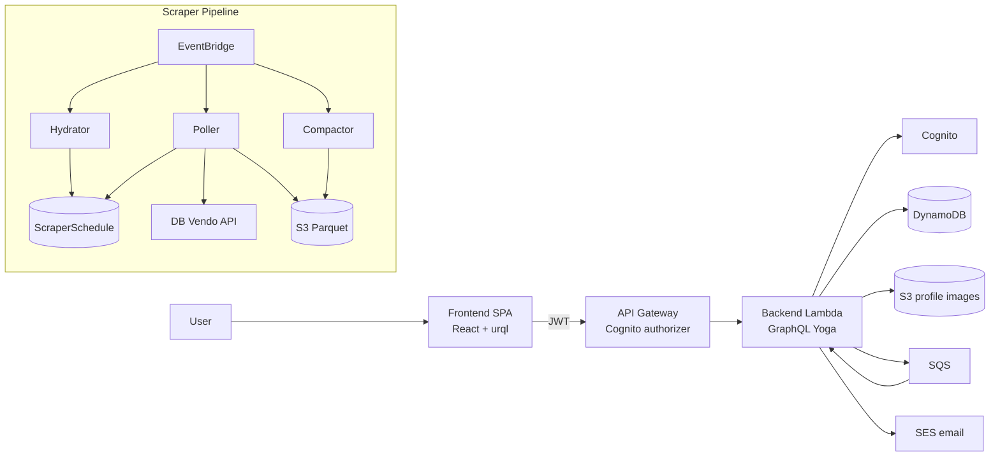

# Project Overview

Train Price Monitor is a serverless web app that tracks Deutsche Bahn ticket prices and notifies
users when a monitored journey rises above a chosen threshold. It pairs a React 19 + Material-UI
frontend with a GraphQL Yoga backend on AWS Lambda, and a standalone scraper pipeline that records
historical fare data to Parquet on S3. Everything is defined as code with AWS CDK v2 and orchestrated
through a `mise` monorepo.

## Repository Structure

- `frontend/` – React 19 SPA (Material-UI v7, urql, Vite); pages, components, hooks, providers.
- `backend/` – GraphQL Yoga API with a native AWS Lambda handler (API Gateway v1/v2 + SQS).
- `scraper/` – Independent serverless pipeline collecting DB price data into Parquet on S3.
- `shared/` – Code shared by more than one module. Currently `db-fetch.ts`, the
  `impit`-backed `fetch` both the backend and the scraper alias `cross-fetch` to.
  It has no `node_modules` of its own: each consuming module type-checks it via its own
  tsconfig (`include` + an `impit` `paths` entry) and bundles it with esbuild.
- `infrastructure/` – AWS CDK v2 stacks (`lib/`), CDK app entry (`bin/`), CDK tests (`test/`).
- `.mise.toml` / `mise.tasks.toml` – Monorepo task definitions shared across modules.
- `eslint.config.cjs` – Shared ESLint v10 flat config.
- `docker-compose.yml` – Local dev services (Floci AWS emulator, backend, frontend).

Each module owns a `mise.toml` whose tasks are reachable as `mise run //module:task`.

## Build & Development Commands

Install tooling once with `mise install`. Per-module commands:

```bash
# Frontend (Vite + React 19)
cd frontend
npm install            # Install dependencies
npm run dev            # Start Vite dev server (port 3000)
npm run build          # Production build to frontend/build
npm test               # Run Vitest tests
npm run typecheck      # TypeScript check
npm run lint           # ESLint check
```

```bash
# Backend (GraphQL Yoga)
cd backend
npm install            # Install dependencies
LOCAL_DEV=1 npm run dev  # Start local HTTP server with hot reload (port 4000)
npm run build          # Bundle with esbuild to backend/dist
npm run codegen        # Generate GraphQL types from schema
npm run typecheck      # TypeScript check
npm run lint           # ESLint check
```

```bash
# Scraper (esbuild → 3 Lambda bundles)
cd scraper
npm install            # Install dependencies
npm run build          # Bundle to scraper/dist/{poller,hydrator,compactor}
npm run typecheck      # TypeScript check
npm run lint           # ESLint check
```

```bash
# Infrastructure (CDK)
cd infrastructure
npm install            # Install dependencies
npm run build          # Compile TypeScript
npm run test           # Run Jest tests
npm run cdk deploy     # Deploy to AWS
npm run cdk diff       # Show diff against deployed stack
npm run typecheck      # TypeScript check
npm run lint           # ESLint check
```

```bash
# Monorepo (mise) — run from any directory
npx pre-commit run --all-files     # Run all pre-commit hooks
mise run //...:build               # Build all modules in parallel
mise run //...:test                # Run tests across all modules
mise run //...:lint                # Lint all modules
mise run //frontend:dev            # Start frontend dev server
mise run //backend:dev             # Start backend local server (sets LOCAL_DEV=1)
mise run //infrastructure:deploy   # Deploy all CDK stacks
```

For a Coder workspace, run `mise run install` and `mise run //backend:codegen` after `mise install`.
AWS SSO remains interactive: configure an AWS profile with `sts:GetCallerIdentity`,
`cloudformation:DescribeStacks`, and `cognito-idp:ListUserPoolClients`, then run
`aws sso login --profile "$AWS_PROFILE"` and `mise run env:local` to generate ignored local
environment files from `InfrastructureStack` outputs. Do not automate or commit AWS credentials.

> `LOCAL_DEV=1` switches the backend entry point from a Lambda handler to a plain HTTP server.
> The `mise run //backend:dev` task sets it automatically.

## Code Style & Conventions

- **TypeScript strict mode** in all modules; explicit param/return types; prefer `interface` for
  object shapes; use `unknown` over `any`.
- Use `const` by default; `let` only when reassignment is needed.
- **No `console.log`** anywhere (`no-console: error`). Backend and scraper log via
  `@aws-lambda-powertools/logger`.
- **Prettier**: `{ "trailingComma": "es5", "tabWidth": 2, "printWidth": 120, "useTabs": false,
"semi": true, "singleQuote": true }`.
- **ESLint** v10 flat config (`eslint.config.cjs`) with `@typescript-eslint` recommended rules.
- **Imports**: external packages first (alphabetical), then internal relative paths, grouped by a
  blank line.
- **Naming**: Components PascalCase; hooks `useX`; utilities/API camelCase; classes/stacks PascalCase;
  constants SCREAMING_SNAKE_CASE; files kebab-case.
- **React**: functional components with hooks; named exports for reusable components, default exports
  for pages; props interface named `<Component>Props`, destructured in the signature.
- **CDK**: extend `cdk.Stack`; descriptive construct IDs; prefer L2 constructs; accept
  `props?: cdk.StackProps`.
- **Commits**: short imperative subject (e.g. `Add price alert threshold validation`); pre-commit
  hooks must pass before committing.

## Architecture Notes



- **Frontend** authenticates via Cognito and calls the GraphQL API; the urql client attaches the JWT.
- **Backend** is split into two Lambdas running the _same_ image: the API function serves
  GraphQL over API Gateway, and a refresher function consumes SQS and the hourly EventBridge
  schedule. Journey search needs live DB access, but the watchlist read path is served purely
  from a DynamoDB snapshot (`cached*` / `lastCheckedAt` on the `Journey` item) that only the
  refresher writes — so rendering the watchlist makes no network calls and a DB outage shows
  `unavailable` instead of failing.
- **Scraper** is fully decoupled: EventBridge schedules drive the Hydrator (seed targets), Poller
  (scrape prices), and Compactor (consolidate Parquet). See `scraper/README.md` for details.

## Testing Strategy

- **Frontend** – Vitest (`*.test.{ts,tsx}`); run `mise run //frontend:test` (or `npm test`).
- **Infrastructure** – Jest with ts-jest (`*.test.ts`); run `mise run //infrastructure:test`.
  Use descriptive names, e.g. `test('SQS Queue Created')`.
- **Scraper / Backend** – No automated test suites yet; rely on `typecheck` + `lint`.
  > TODO: add unit coverage for scraper TTD tiering and Parquet serialization.
- **CI** – `mise run //...:test` and `mise run //...:lint` run all modules; `pre-commit` enforces
  formatting and linting on every commit.

## Security & Compliance

- Never commit `.env` files or secrets; secrets are injected by CDK at deploy time.
- API Gateway uses a Cognito authorizer — all GraphQL requests need a valid JWT (handled by the
  frontend urql client).
- IAM follows least privilege; the scraper grants only the table/bucket access each Lambda needs.
- Pre-commit hooks enforce: trailing-whitespace, LF line endings, valid YAML/JSON, Prettier, ESLint.
  Install with `pip install pre-commit && pre-commit install`.
- Licensed under GPL-3.0.
  > TODO: document dependency-scanning tooling (e.g. Dependabot / npm audit) if/when adopted.

## Agent Guardrails

- Never edit generated or vendored files: `**/dist/`, `**/node_modules/`, `**/cdk.out/`,
  GraphQL codegen output, and `package-lock.json` (change deps via `npm install`).
- Do not commit `.env` or any credentials; do not weaken the Cognito authorizer.
- Respect esbuild bundling rules below — wrong `--external` flags crash Lambdas at runtime.
- Infra changes: run `npm run build` and `npm run cdk diff` before any deploy; never `cdk deploy`
  without a human reviewing the diff.
- Keep `no-console` clean; use the powertools logger in backend/scraper.

**DB transport** (`shared/db-fetch.ts`):

- **History.** 2026-09: DB's Akamai edge started rejecting every non-browser TLS/HTTP2 fingerprint
  with `403 OPS_BLOCKED` (Node fetch/undici, curl-impersonate, Bun, all db-vendo-client profiles).
  A real Chromium worked until 2026-10-13, when DB also refused headless Linux browsers — real
  Chrome, Chromium, Firefox, patchright, Camoufox, headless and headful — even from a residential
  IP, while a Windows/macOS consumer browser on the same network was allowed. A managed
  unblocking-browser vendor (Bright Data's Browser API) was used next; it needs business KYC
  (`int.bahn.de/robots.txt` disallows `/web/`), fell back to datacenter egress and billed ~670 KB per
  session, so it was dropped. Browser-as-a-service fleets (Kernel, Browserless incl. its OS
  emulation) and unblocker APIs (ZenRows, ScrapingAnt) were tested on 2026-10-19 and are all refused.
- **What works (measured 2026-10-19):** [`impit`](https://github.com/apify/impit), a Rust HTTP
  client that imitates a browser's TLS and HTTP/2 handshake. With the **Firefox** profile DB answers
  201, from a residential IP and from AWS Lambda in eu-central-1; the Chrome profile still gets 403.
  No browser, no proxy, no vendor account. Apify's DB actor most likely works the same way.
- **Only `Content-Type`/`Accept` plus `Origin`/`Referer` are sent.** db-vendo-client's own
  User-Agent and correlation headers turn an accepted request into a 403, so the transport drops
  them. Both the backend and the poller esbuild-`alias` `cross-fetch` to this module, so
  `db-vendo-client`'s request building and response parsing stay untouched.
- **Pacing.** DB throttles an egress IP that bursts: 6 parallel calls were fine, 60 at concurrency 6
  got the IP a `429` for minutes, 24 calls one at a time with 2.5 s gaps all passed. The module spaces
  request starts (`DB_MIN_GAP_MS`) and caps in-flight requests (`DB_MAX_IN_FLIGHT`). The poller runs
  at 2.5 s / 2 in flight with a batch of 25 targets (50 calls), every 15 minutes — ~2,400 scrapes a
  day, above the ~1,654 the TTD intervals need, so the backlog drains in about a week. Raise
  `SCRAPER_BATCH_SIZE` only while the `transport` counters in the "Poller finished" log stay clean.
- **Priority.** The schedule table's index is `ByDue` (`status` + `due_key`, where `due_key` is
  `<tier rank>#<next_scrape_at>`). The poller queries it once per tier in order NEAR → MID → FAR, so
  when capacity falls short it is the far end of the horizon that slips, not next week's trips.
  Targets whose departure day has passed are deleted instead of scraped — DB returns no prices for
  them and they would only consume the batch.
- **Circuit breaker.** After `DB_BREAKER_THRESHOLD` consecutive failed requests the environment stops
  calling DB for `DB_BREAKER_COOLDOWN_MS`: hammering a throttled IP only extends the ban. With a Decodo
  key configured the request falls back to Decodo; without one it throws `DbThrottledError`, and the
  poller ends its batch (the untouched targets are retried by the next run).
- **Decodo fallback (backend only).** The API and refresher functions have `DECODO_API_KEY_PARAM`
  and use Decodo's `/scrape` (premium pool; the standard pool cannot send custom headers and is
  refused) when the direct path is throttled. **The poller has no key on purpose**: it is bulk work and
  must never spend the free allowance (5K calls/month). `DB_TRANSPORT=decodo` forces the fallback (kill
  switch). The key lives in an SSM **SecureString** that CI writes from the repository secret
  `DECODO_API_KEY`; the functions get only the parameter _name_, so it never appears in a template, in
  `cdk diff` or in a function's environment. IAM grants exactly `ssm:GetParameter` on that parameter
  (no `kms:Decrypt` is needed with the AWS-managed `aws/ssm` key). **Rotation:** update the repo secret
  and re-run the deploy job; running environments converge within `DECODO_KEY_TTL_MS` (15 min).
- **Fingerprints get blocked once popular** (reported in db-vendo-client#46: ~1–2 weeks). If the
  direct path starts failing, try another profile with `DB_IMPIT_BROWSER` (e.g. `firefox144`) or bump
  `impit`; Decodo keeps search and refresh working meanwhile.
- **Packaging.** `impit` is a native module: it is **external** in both bundles and shipped in the
  images (backend: all production dependencies; poller: `impit` and `impit-linux-x64-gnu` only). The
  Dockerfiles install with `--os=linux --cpu=x64 --libc=glibc` so the Lambda binary is picked
  regardless of the build host; the Lambdas are x86_64. `@aws-sdk/client-ssm` is external in the
  backend bundle (present in the image) and provided by the Node.js 24 runtime for the scraper; the
  transport imports it lazily, so local development never touches SSM.
- **Pause switch.** `CDK_SCRAPER_PAUSED=1` (repo variable) disables the poller and hydrator schedules
  in CDK; unlike a manual console change it survives deploys. It also disables the alarm actions of
  the poller alarms, so a deliberate pause never pages anyone.

**Monitoring** (`infrastructure/lib/alerting.ts`, alarms in `backend.ts` and `scraper-stack.ts`):

- **One alert topic** (`TrainPriceMonitorAlerts`, in `AlertingStack`) receives every CloudWatch alarm
  state change. A small Lambda (`PushoverForwarder`) forwards them to Pushover: ALARM at high
  priority with the siren sound (bypasses quiet hours), recovery at normal priority, with a link to
  the alarm in the console. SNS cannot deliver to Pushover directly — it requires an HTTPS endpoint
  that answers its `SubscriptionConfirmation` handshake.
- **Credentials** live in two SSM SecureStrings (`/train-price-monitor/pushover-token`,
  `/train-price-monitor/pushover-user-key`) written by CI from the repo secrets `PUSHOVER_API_TOKEN`
  and `PUSHOVER_USER_KEY`; the forwarder's role can read exactly those two parameters.
- **Nine alarms** — the CloudWatch free tier allows 10 alarm metrics, 10 custom metrics and 3
  dashboards; we use 9, 4 and 2. Four custom metrics come from log filters on the existing log
  lines (`PollerDirectOk`, `PollerThrottled`, `PollerRunMs` from "Poller finished",
  `SearchFallbackOk` from "GraphQL response"), so no application code emits metrics.
  - Scraper: `PollerNotRunning` (0 invocations for 45 min, missing data treated as breaching),
    `PollerErrors`, `PollerThrottledByDb` (early warning that DB is throttling the fingerprint),
    `PollerNoPrices` (no direct success for 45 min), `PollerRunTooSlow` (>190 s of the 210 s abort).
  - Backend: `SearchErrors`, `SearchUsingDecodoFallback` (direct transport degraded for users),
    `RefresherErrors`, `SearchThrottled`.
- **Dashboards** (48 h default, `infrastructure/lib/dashboards.ts`) follow Google's Four Golden
  Signals — one row each for latency, traffic, errors and saturation, plus the alarm state:
  - `TrainPriceMonitor-Scraper`: run duration (p90/max vs the 210 s abort), scrapes per run,
    failed target scrapes + pipeline errors, DB-throttled calls + backlog (1 when the due queue is
    deeper than one batch), plus a **Data** section (price rows written per run) and a diagnostics
    table of the last failed scrapes.
  - `TrainPriceMonitor-App`: API p50/p90/p99 and integration p90 (the 1 s "flow" limit applies to
    the interactive p50; journey searches take 2-6 s, so the graph marks 8 s as their p99 budget),
    requests per 5 min, 4xx/5xx plus the implicit failure (DB refused, Decodo served), Lambda
    concurrency/throttles plus DLQ depth, plus a **Notifications** section (SES sends and
    deliveries) and a diagnostics table of the last API errors. The error rate counts 5xx only —
    4xx here is expired-token noise from the SPA.
  - Each signal pairs a graph with a gauge or number; budget/limit lines are annotations on the
    graph. Rates and percentiles, not totals. The SQS queue is not shown — one message per hour is
    consumed in under a second.
- **Do not add a tenth alarm or a fifth custom metric** without accepting cost ($0.10 and $0.30 per
  month respectively), and do not use metric-math, Metrics Insights or anomaly-detection bands in
  alarms — those are billed differently from the free alarm metrics.

**Backend esbuild bundling** (`--format=cjs`):

- Do NOT externalize ESM-only packages — they cannot be `require()`d and crash Lambda with
  `UserCodeSyntaxError` (API Gateway then returns a 502, often misreported as CORS).
- `db-vendo-client` must be **bundled** (ESM-only).
- The station index for autocomplete is **generated and bundled**: `backend/src/stations/stations.json`
  comes from `db-hafas-stations` via `npm run stations` (wired into `pretypecheck`/`prebuild`), and the
  package itself is a devDependency that never ships. Reading the package at runtime cost ~1.1 s on the
  first `locations` call per cold environment and added 133 MB to the image; the generated index parses
  in ~20 ms and is 0.67 MiB. The output is **not committed** (the pre-commit hook rejects files over
  500 KB) — it is regenerated before typecheck and build.
- The bundle is built on the host, not inside Docker: it pulls in `shared/`, which is outside
  the image's build context. `mise run //infrastructure:deploy` builds it first.

**Scraper esbuild bundling** (`--format=esm`):

- AWS SDK packages are externalized (provided by the Node.js 24 runtime).
- The poller bundle needs a CJS `require()` shim banner for CJS-only transitive deps
  (`qs` → `object-inspect` calling `require('util')`).

## Extensibility Hooks

Environment variables (never commit values):

| Variable                     | Module            | Description                                                       |
| ---------------------------- | ----------------- | ----------------------------------------------------------------- |
| `PROFILE_IMAGE_BUCKET_NAME`  | Backend           | S3 bucket name for profile images                                 |
| `TPM_SQS_QUEUE_URL`          | Backend           | SQS queue URL for journey monitor updates                         |
| `SES_FROM_EMAIL`             | Backend (Lambda)  | Sender address for SES emails (injected by CDK)                   |
| `FRONTEND_URL`               | Backend (Lambda)  | Frontend base URL for notification links                          |
| `LOCAL_DEV`                  | Backend           | `1` starts an HTTP server instead of the Lambda handler           |
| `PORT`                       | Backend           | HTTP port for local dev server (default `4000`)                   |
| `DB_MIN_GAP_MS`              | Backend + Scraper | Minimum spacing between DB request starts (default `1000`)        |
| `DB_MAX_IN_FLIGHT`           | Backend + Scraper | Concurrent DB requests (default `2`)                              |
| `DB_MAX_ATTEMPTS`            | Backend + Scraper | Direct attempts per request (default `2`)                         |
| `DB_RETRY_BACKOFF_MS`        | Backend + Scraper | Pause before a retry, times the attempt number (default `3000`)   |
| `DB_REQUEST_TIMEOUT_MS`      | Backend + Scraper | Per-attempt timeout (default `20000`)                             |
| `DB_BREAKER_THRESHOLD`       | Backend + Scraper | Consecutive failed requests that open the breaker (default `3`)   |
| `DB_BREAKER_COOLDOWN_MS`     | Backend + Scraper | How long the breaker stays open (default `180000`)                |
| `DB_IMPIT_BROWSER`           | Backend + Scraper | impit browser profile (default `firefox`; Chrome profiles fail)   |
| `DB_TRANSPORT`               | Backend           | `decodo` forces the Decodo fallback (kill switch)                 |
| `DECODO_API_KEY`             | Backend           | Decodo key, literal (local dev; wins over `_PARAM`)               |
| `DECODO_API_KEY_PARAM`       | Backend           | SSM SecureString name holding the Decodo key (injected by CDK)    |
| `DECODO_KEY_TTL_MS`          | Backend           | How long a resolved Decodo key is cached (default 15 min)         |
| `REACT_APP_GRAPHQL_ENDPOINT` | Frontend          | API Gateway base URL                                              |
| `CDK_APP_NAME`               | Infrastructure    | Application name (overrides CDK context)                          |
| `CDK_DOMAIN_NAME`            | Infrastructure    | Custom domain name for the deployment                             |
| `CDK_SES_FROM_EMAIL`         | Infrastructure    | Sender email injected as Lambda `SES_FROM_EMAIL`                  |
| `CDK_DECODO_API_KEY_PARAM`   | Infrastructure    | SSM SecureString name for the Decodo key                          |
| `PUSHOVER_API_TOKEN`         | Infrastructure    | Pushover application token (repo secret; CI writes the SSM param) |
| `PUSHOVER_USER_KEY`          | Infrastructure    | Pushover user key (repo secret; CI writes the SSM param)          |
| `PUSHOVER_TOKEN_PARAM`       | Alerting Lambda   | SSM parameter name for the Pushover app token (injected by CDK)   |
| `PUSHOVER_USER_PARAM`        | Alerting Lambda   | SSM parameter name for the Pushover user key (injected by CDK)    |
| `CDK_SCRAPER_PAUSED`         | Infrastructure    | `1` disables the poller and hydrator schedules                    |
| `SCRAPER_TABLE_NAME`         | Scraper           | DynamoDB schedule table (injected by CDK)                         |
| `SCRAPER_BUCKET_NAME`        | Scraper           | S3 bucket for Parquet data (injected by CDK)                      |
| `SCRAPER_BATCH_SIZE`         | Scraper           | Targets per poller run (default `10`, CDK sets `25`; 1 = 2 calls) |
| `HYDRATOR_LOOKAHEAD_DAYS`    | Scraper           | Days ahead to seed (default `60`)                                 |
| `HYDRATOR_SEED_WINDOW_DAYS`  | Scraper           | Newest days re-seeded per nightly run (default `3`)               |
| `HYDRATOR_FULL_SEED`         | Scraper           | `1` seeds the whole window and prunes beyond it (manual)          |
| `AWS_ENDPOINT_URL`           | Scraper           | Local Floci endpoint (set by mise tasks)                          |

- Add CDK stacks under `infrastructure/lib/` and wire them in `infrastructure/bin/`.
- Extend scrape coverage by editing `scraper/stations.json` (route catalog is auto-generated).
- New GraphQL resolvers: edit the schema, run `npm run codegen`, then implement the resolver.

## Further Reading

- [scraper/README.md](scraper/README.md) – Scraper architecture, Parquet schema, local Floci dev.
- [infrastructure/README.md](infrastructure/README.md) – CDK stacks and mise deploy tasks.
- [README.md](README.md) – Product overview, getting started, usage.
- `CDK_APP_NAME`, `CDK_DOMAIN_NAME`, `CDK_SES_FROM_EMAIL` must be set before `cdk deploy`
  (env vars or `-c` context); missing values fail at synth time.
- Backend log group: `/aws/lambda/InfrastructureStack-BackendGraphql*`.
  Scraper log groups: `/aws/lambda/ScraperStack-Scraper*`. Docker Lambda cold start is ~15s.
