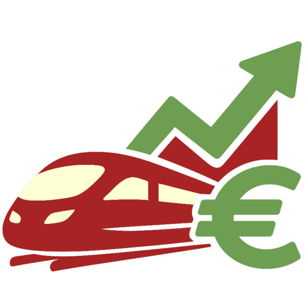
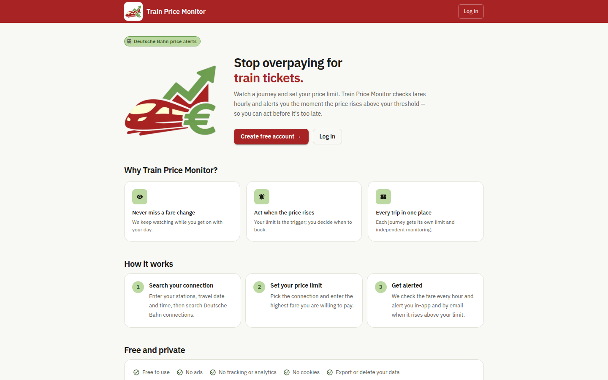
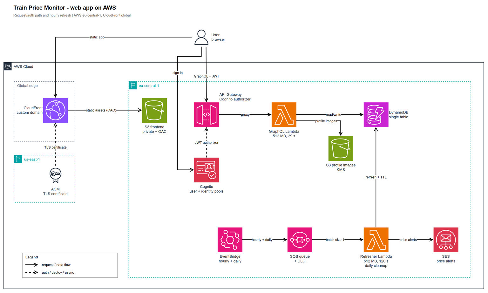

<p align="center">
  
</p>

<h1 align="center">Train Price Monitor</h1>

<p align="center"><em>Deutsche Bahn fare alerts when a monitored journey reaches your price limit.</em></p>

<p align="center">
  <a href="https://github.com/wolfm89/train-price-monitor/actions/workflows/ci.yaml"></a>
  <a href="LICENSE"></a>
  <a href="https://github.com/wolfm89/train-price-monitor/tags"></a>
  <a href="https://tpm.wolfgangmoser.eu"></a>
  <a href=".nvmrc"></a>
</p>

<p align="center">
  <a href="https://tpm.wolfgangmoser.eu">Live demo</a> ·
  <a href="docs/architecture.md">Architecture</a> ·
  <a href="docs/README.md">Documentation</a> ·
  <a href="docs/privacy.md">Privacy</a>
</p>

Train Price Monitor is a serverless web app for watching Deutsche Bahn connections. Search for a
journey, set a price limit, and the app checks the fare hourly. When a watched fare climbs to or past
your limit, it creates an in-app notification and sends an email unless you turn email alerts off.

The project also contains a historical data pipeline: a scraper collects fare observations as
Parquet on S3, and a weekly analytics build turns them into a typed silver dataset with a quality
report.



## Features

- Search Deutsche Bahn connections and page to earlier or later departures.
- Watch a journey with an individual price limit and travel preferences.
- Hourly fare checks with in-app notifications and email alerts (on by default).
- Current price, limit and journey status on the watchlist; expired journeys are cleaned up.
- Download your stored data or delete your account from the profile page.
- Historical Parquet collection, silver analytics builds and a weekly quality report.
- Automatic cleanup of expired journeys and price-alert notifications.

## Quick start

You need [mise](https://mise.jdx.dev/) and an AWS SSO profile with access to a deployed
`InfrastructureStack` for the generated frontend/backend environment. The full local setup is in
[docs/development.md](docs/development.md).

```bash
git clone https://github.com/wolfm89/train-price-monitor.git
cd train-price-monitor
export AWS_PROFILE=<profile>
aws sso login --profile "$AWS_PROFILE"
mise install
mise run install
mise run env:local          # reads CloudFormation outputs
mise run dev:frontend       # Vite on http://localhost:3000
```

Run the backend in a second terminal with `mise run dev:backend` (port 4000). The Docker Compose
stack is an alternative to the two local servers; see [docs/development.md](docs/development.md#local-workflows)
for its environment requirements. Without `env:local`, the frontend has no Cognito or GraphQL
configuration and cannot sign in.

## Architecture

The web app runs on CloudFront and S3, authenticates with Cognito, and calls a GraphQL Lambda through
API Gateway. A second Lambda consumes the hourly refresh, daily cleanup and notification-email SQS messages; DynamoDB stores users,
journeys and notifications; S3 stores profile images. The scraper and analytics pipelines share the
same AWS account and data bucket but run independently.



See [docs/architecture.md](docs/architecture.md) for the request path, hourly refresh, scraper and
analytics diagrams, data model and design decisions.

**Built with** React 19 · TypeScript · GraphQL Yoga · AWS CDK · Lambda · DynamoDB · S3 · Parquet and
DuckDB.

## Documentation

| Document                                   | What it covers                                                                                    |
| ------------------------------------------ | ------------------------------------------------------------------------------------------------- |
| [Architecture](docs/architecture.md)       | System context, request and refresh flows, scraper and analytics pipelines, diagrams, data model. |
| [Deployment](docs/deployment.md)           | Stacks and regions, CDK inputs, bootstrap, outputs, verification, pause and rollback.             |
| [Development](docs/development.md)         | Toolchain, local environment, frontend/backend/Docker workflows, tests and troubleshooting.       |
| [Configuration](docs/configuration.md)     | Canonical environment-variable reference and secret handling.                                     |
| [Operations](docs/operations.md)           | Alarms, dashboards, budget, alert routing and runbooks.                                           |
| [Privacy](docs/privacy.md)                 | What the app stores, logging/export/retention rules and the public policy.                        |
| [Scraper](scraper/README.md)               | Bronze Parquet pipeline, TTD tiers, schema and Floci development.                                 |
| [Analytics](analytics/README.md)           | Silver transform, quality gate/report, column contract and local DuckDB runs.                     |
| [Infrastructure](infrastructure/README.md) | CDK stacks and mise commands.                                                                     |

## Deployment

Five CDK stacks deploy to AWS: `InfrastructureStack`, `AlertingStack`, `ScraperStack` and
`AnalyticsStack` in `eu-central-1`, plus `CertificateStack` in `us-east-1`. The repository's CI
deploys `main`; manual deployments use the documented mise task after a reviewed `cdk diff`. Start
with [docs/deployment.md](docs/deployment.md).

## Privacy and security

The hosted instance is covered by the [privacy policy](https://wolfgangmoser.eu/privacy-policy/) and
the [legal notice](https://wolfgangmoser.eu/legal-notice/). [docs/privacy.md](docs/privacy.md)
summarises the implementation rules. Report vulnerabilities privately as described in
[SECURITY.md](SECURITY.md).

## Contributing

Contributions are welcome. Read [CONTRIBUTING.md](CONTRIBUTING.md) for the local checks, pre-commit
setup, test commands and pull-request expectations.

## License

GPL-3.0. See [LICENSE](LICENSE).

Train Price Monitor is an independent project and is not affiliated with Deutsche Bahn AG.
