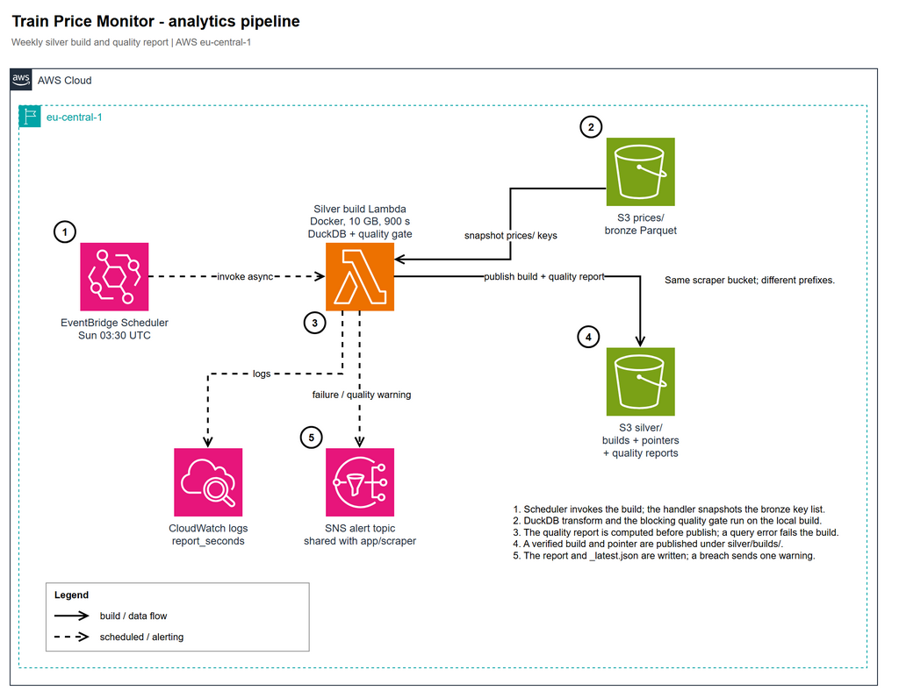

# Analytics

Silver-layer builds for the Train Price Monitor price dataset.

> Part of [Train Price Monitor](../README.md). See [Architecture](../docs/architecture.md#analytics-pipeline),
> [Deployment](../docs/deployment.md) and [Operations](../docs/operations.md) for the wider system.



Bronze (`s3://<scraper-bucket>/prices/`) is the scraper's Parquet output, partitioned by observation
day. The compactor rewrites a day's `batch_*` files into one `daily_*` file, so bronze is
append-and-rewrite, not immutable. The build lists the objects once and reads exactly that list, so
a batch the poller appends mid-build is simply not part of that build; the manifest records the same
list. The list is not an immutable snapshot: a compactor run that deletes a listed `batch_*` file
before DuckDB reads it can still cause a missing-object failure. The 03:00 compactor and 03:30 build
schedule normally leave a 30-minute gap; do not run them together. Silver is the conformed
snapshot the model work reads: typed, with v1/v2 semantics normalised, station context joined and
departure-month partitions.
Every run rebuilds it from scratch, so the same input produces the same rows; row order and file
split are not stable, and each build needs its own target directory and room on disk for the output
plus the spill directory (both live next to the target). Duplicate observations are removed using
the compactor's key and reported in the build stats.

## Scope of this module (v1)

Shipped here:

- `src/tpm_analytics/sql/silver.sql` — the one deterministic transform.
- `src/tpm_analytics/silver/build.py` — DuckDB session, transform execution, local Parquet output.
- `src/tpm_analytics/silver/quality.py` — the gates that must pass before a build is published.
- `src/tpm_analytics/calendar.py` — loader and DuckDB join for the training-time holiday calendar.
- `src/tpm_analytics/data/calendar.json` — generated public/school-holiday dataset (ODbL).
- `src/tpm_analytics/data/NOTICE` — data licence and attribution.
- `scripts/build_calendar.py` — manual generator for that dataset.
- `tests/` — fixture-based tests over v1-only, v2-only and mixed bronze files.

The S3 writer, manifest, pointer and Lambda handler are implemented (`publish.py`, `manifest.py`,
`handler.py`). The `AnalyticsStack` adds the image Lambda, the weekly EventBridge Scheduler trigger,
the least-privilege IAM and the failure SNS path; `ScraperStack` adds the `silver/` multipart-abort
rule. See [Deployment](#deployment).
The handler lists the bronze keys once and builds from that list, so the poller's 15-minute appends
cannot change the corpus under a nine-minute build. The list is not immutable: a compactor delete of
a listed batch can still race with the read, so keep manual builds clear of compaction.

The CLI still writes to a local directory. Reading `s3://` requires S3 credentials passed to
`run_build`; the Lambda handler supplies them from its execution role.

The SQL and the station dimension live inside the package (`src/tpm_analytics/{sql,data}`), so a
built wheel is self-contained and the image only has to copy `tpm_analytics/`.

DuckDB is pinned at 2.0.0. The transform uses `COPY … RETURN_STATS`, so the row and partition counts
come from the writer; the gate then re-counts the rows from disk and checks the partition count
against the directory tree.

## Local commands

```bash
cd analytics
uv sync --frozen        # create .venv from the lockfile (uv also provisions Python 3.15)
uv run pytest           # fixture tests
uv run ruff check .     # lint
uv run ruff format .    # format
uv run ty check         # type check
uv build                # wheel + sdist, assets included
```

Or via mise from anywhere in the repo:

```bash
mise run //analytics:test
mise run //analytics:lint
mise run //analytics:typecheck
mise run //analytics:build
```

## Running the transform locally

```bash
uv run python -m tpm_analytics.silver.build \
  --source '/path/to/bronze/prices/**/*.parquet' \
  --target /tmp/silver
```

The output is Hive-partitioned by `departure_year`/`departure_month`, ZSTD-compressed. ZSTD is the
measured choice: on a 4.4M-row partition it produced 127 MB against 169 MB for snappy, 142 MB for
gzip and 171 MB for lz4, at 5.9 s write time versus 4.6 s for snappy; full-column reads were equal
within noise. Storage and upload dominate a weekly batch, so the smaller file wins. The build
writes into a hidden sibling directory, runs the quality gate, and only then renames it into place,
so a rejected build leaves no target behind. `--stations` overrides the station dimension and
`--no-verify` skips the gate (debug only, prints a warning). Exit code 2 means the build was
refused: an existing target, a failed gate, an empty corpus, a URI instead of a path, or a
DuckDB/OS error. argparse also exits 2 for a usage error. Linux and macOS are supported;
Windows is untested.

## Scale (measured 2026-11-16)

The full history is 107,337,180 bronze rows in 245 files (1.7 GB) and produces 1.5 GB of silver in
8 departure-month partitions. The first production invocation with 8 GB DuckDB memory, 4 threads and a 5 GB temp limit failed
after 66 s when DuckDB's spill cap was exhausted (`5GB` is decimal, 4.7 GiB; the 10,231 MB Max Memory
reported by Lambda includes `/tmp` page cache, not a Lambda OOM). The working local profile is 6 GB
DuckDB memory, 2 threads and a 7 GB temp limit (`7GB` = 6.5 GiB): the verified build takes 8m04s,
removes 1,162 duplicate observations and peaks at 3.5 GB of spill. The dedupe computes a null-safe
key hash, identifies only the repeating keys and applies the row window to that small set; a global
window over all rows needs more than 9 GB of spill. The deployed Lambda builds took 576 s / 573 s
(build phase) and removed 1,164 duplicates; `build_budget_seconds=690` leaves room for the 20 s
publish.

The Lambda is sized for that corpus: 10,240 MB memory, 10,240 MB ephemeral storage, 900 s,
`memory_limit=6GB`, `threads=2`, `SILVER_MAX_TEMP_SIZE=7GB`. Measure the next production run before
trusting the schedule. If the corpus outgrows it, split the build by departure month.

```bash
uv run python -m tpm_analytics.silver.build \
  --source '/data/prices/**/*.parquet' --target /data/silver \
  --threads 2 --memory-limit 6GB --max-temp-size 7GB
```

Re-run this before an engine upgrade and before the stack lands. It is not part of CI.

## Publishing

The Lambda handler builds into a local temp directory, verifies it, and publishes:

```
silver/builds/<build id>/departure_year=YYYY/departure_month=MM/*.parquet
silver/builds/<build id>/_manifest.json
silver/_latest.json
```

- The **manifest** records `build_id`, the source glob and the exact object list that was read,
  rows in/out, duplicates removed, partitions, duration, transform version, DuckDB version,
  SHA-256 of the SQL, station dimension and constants, the handler warnings, and every output
  file with its size. The bucket
  comes from the store that wrote the bytes, so it cannot disagree with them. An empty
  `TRANSFORM_VERSION` falls back to the SQL hash, so provenance is never blank.
- The **pointer** is written last, after the manifest is read back and every file is present with
  the recorded size. The pointer write is the commit point: an exception before it deletes the
  half-written build; a pointer PUT that errors is assumed to have landed and the build is kept.
  A killed process (timeout, OOM) cannot clean up: it leaves a prefix without a manifest.
  Retention reclaims such a prefix once it is older than an hour, which is long after any
  in-flight upload could still be running.
- **Retention** keeps the newest two builds (`SILVER_KEEP`, minimum 2 so one cycle of readers
  always survives), only counts ids that match the build-id format and have a readable,
  consistent manifest, never deletes the build the pointer names, and only deletes a complete
  build once it is a day old. A manifest that cannot be read is never deleted.
- **Refusals:** a corpus that shrank by more than 10 % against the pointed-at build, more than
  0.01 % removed rows, or removed rows that are not exactly the duplicates in bronze.
- The handler ignores the event: source, bucket, prefix, sizing, alert topic and log group come from
  the environment (`SILVER_BUCKET`, `SILVER_PREFIX`, `BRONZE_SOURCE`, `SILVER_THREADS`,
  `SILVER_MEMORY_LIMIT`, `SILVER_MAX_TEMP_SIZE`, `SILVER_KEEP`, `TRANSFORM_VERSION`,
  `ALERT_TOPIC_ARN`, `LOG_GROUP_NAME`), so an invocation cannot disable the gate. `TRANSFORM_VERSION` is the commit SHA
  in CI; empty falls back to `sql-<hash>`. Any handler exception is re-raised with the structured
  `silver_build_failed` payload as its message; the Lambda on-failure destination publishes it after
  the retries. A handled failure does not move the pointer.

For local S3 reads, install the extension once and point DuckDB at it:
from `analytics/`, `mise run //analytics:httpfs` then
`DUCKDB_EXTENSION_DIR=.duckdb-extensions` (the script and the variable are CWD-relative).
The Lambda image bakes the same extension into `/opt/duckdb/extensions`.

`tests/test_publish.py` and `tests/test_handler.py` exercise the whole path against a local
`ObjectStore`, and `tests/test_storage.py` covers the S3 implementation with botocore's
`Stubber`. The tests never write to AWS.

## Deployment

`AnalyticsStack` deploys the Docker image as an x86_64 Lambda with 10,240 MB memory, 900 s timeout,
10,240 MB ephemeral storage, no VPC and reserved concurrency 1. EventBridge Scheduler runs it every
Sunday at 03:30 UTC, after the 03:00 compactor. It reads `prices/`, writes `silver/` and keeps the
newest two builds; quality reports are kept indefinitely. IAM is prefix-scoped: read bronze,
read/write silver and delete/abort only under `silver/builds/`.

Full stack, bootstrap, inputs and outputs are in [Deployment](../docs/deployment.md). Set
`CDK_ANALYTICS_PAUSED=1` for a paused deploy; CI defaults to paused when the repository variable is
unset. Enable it with `0` after the first-run checks.

First run:

```bash
cd ../infrastructure
CDK_APP_NAME=TrainPriceMonitor CDK_DOMAIN_NAME=example.com CDK_SES_FROM_EMAIL=noreply@example.com \
  CDK_ANALYTICS_PAUSED=1 CDK_TRANSFORM_VERSION="$(git rev-parse HEAD)" \
  npx cdk deploy AnalyticsStack
FN=$(aws cloudformation describe-stacks --stack-name AnalyticsStack \
  --query "Stacks[0].Outputs[?OutputKey=='SilverFunctionName'].OutputValue" --output text)
aws lambda invoke --function-name "$FN" --invocation-type Event \
  --payload '{}' --cli-binary-format raw-in-base64-out /tmp/silver.json
```

The invoke is asynchronous; `/tmp/silver.json` contains `{"StatusCode": 202}`. Wait about 12
minutes, or watch the log group for `silver build finished`, then inspect `silver/_latest.json`,
`silver/builds/<id>/_manifest.json` and `silver/quality/_latest.json`. A synchronous invoke can
outlive the CLI connection and create a duplicate build.

A failed attempt raises a `silver_build_failed` payload and the on-failure destination publishes one
notification after every retry fails. A report-query failure fails the build before the pointer
moves; a report-write failure after publish is logged and does not roll back. See
[Operations](../docs/operations.md) for runbooks.

## Quality report

Every successful build writes a weekly quality profile:

```
silver/quality/<build_id>.json
silver/quality/_latest.json
```

`_latest.json` is a small pointer to the newest report:

```json
{
  "build_id": "20261122T033000Z-abcdef12",
  "report": "silver/quality/20261122T033000Z-abcdef12.json",
  "generated_at": "2026-11-22T03:42:00+00:00"
}
```

The report is `report_version: 1` and has this shape:

```json
{
  "report_version": 1,
  "build_id": "...",
  "generated_at": "...",
  "status": "ok",
  "window": { "days": 7, "baseline_days": 28 },
  "metrics": {
    "rows": { "by_observed_day": [], "last_7d": 0, "prior_7d": 0, "change_pct": null },
    "routes": { "expected": 140, "active_last_7d": 140, "coverage": 1.0 },
    "route_days": {
      "expected": 980,
      "observed": 980,
      "final_7d_covered": 0,
      "final_7d_coverage": 0.0,
      "final_24h_covered": 0,
      "final_24h_coverage": 0.0
    },
    "nulls": { "fare": { "rate": 0.0, "v2_rate": 0.0 }, "load_factor": { "rate": 0.0 } },
    "freshness": { "latest_observed_at": "...", "hours": 0.0 }
  },
  "thresholds": {
    "expected_route_count": 140,
    "final_7d_coverage_min": 0.8,
    "final_24h_coverage_min": 0.6,
    "route_coverage_min": 0.9,
    "rows_drop_pct_max": 0.35,
    "freshness_hours_max": 36,
    "fare_null_rate_max": 0.1,
    "load_factor_null_rate_max": 0.35
  },
  "violations": [{ "metric": "...", "value": 0.0, "threshold": 0.0, "message": "..." }],
  "build": { "manifest": "silver/builds/<id>/_manifest.json", "rows_out": 0, "partitions": 8 }
}
```

Rows per observed day and `build.partitions` are report-only. The tripwire thresholds live in
`silver-config.json` under `quality`:

| Metric                  | Warning when                            |
| ----------------------- | --------------------------------------- |
| `final_7d_coverage`     | below 0.80                              |
| `final_24h_coverage`    | below 0.60                              |
| `route_coverage`        | below 0.90 of the 140-route catalogue   |
| `rows_change`           | more than 35 % below the preceding week |
| `freshness_hours`       | newest observation older than 36 h      |
| `fare_null_rate`        | above 0.10                              |
| `load_factor_null_rate` | above 0.35                              |

`rows_last_7d`, `route_days_observed` and `route_count_mismatch` are also emitted as violations but
have no configurable threshold.

`final_7d_coverage` and `final_24h_coverage` count completed route-days whose newest observation
**at or before the day's first departure** is no more than 7 days / 24 hours older than that first
departure. They measure coverage before the route-day starts, not the scraper's final 3-hour
window, which lands after the first departure for most route-days; `freshness_hours` and `rows`
cover the overall scrape gap. Re-anchoring these two metrics on the day's last departure is a
candidate for `report_version: 2`.

Initial baseline (2026-11-16 production build `20261116T213950Z-513cc946`): 504,383 rows in the
last 7 days (583,516 prior, −13.6 %), 140/140 active routes, 980 completed route-days, final-7d
coverage 0.8847, final-24h 0.7622, fare null rate 4.01 % (v2 7.18 %), load-factor null rate
27.96 %, freshness 4.08 h, report generation 3.5 s / 3,555 bytes, status `ok`. The 0.80/0.60
thresholds are regression tripwires below this baseline, not a statement that current coverage is
failing.

A breach publishes one normal-priority `silver_quality_failed` event listing up to ten violations
(the Pushover message shows the first three plus a count); it does not fail the build or move the
pointer back. A report-query failure fails the build before publish; a report-write failure after
publish is logged and leaves the verified build in place. A pointer-write failure after the report
lands still returns the versioned report key and leaves `_latest.json` stale. Report writes use one
attempt with short
SDK timeouts. If less than 20 s remain after publish, the report write is skipped; after a
successful write, the warning is skipped if less than 20 s remain. Reports are kept indefinitely
for now; the two-build retention only applies to `silver/builds/`.

Fetch the latest report with AWS credentials:

```bash
BUCKET=$(aws cloudformation describe-stacks --stack-name ScraperStack --region eu-central-1 \
  --query "Stacks[0].Outputs[?OutputKey=='ScraperBucketName'].OutputValue" --output text)
aws s3 cp "s3://$BUCKET/silver/quality/_latest.json" - --region eu-central-1
```

The report contains counts, rates and timestamps over the scraped corpus; no route IDs, station
IDs, prices or user data.

## Column contract

Silver has the 22 bronze columns plus the columns below. Each file carries 37 columns; the
partition columns `departure_year`/`departure_month` exist only in the directory path, so a hive read
yields 39.

| Column                                             | Rule                                                                                                                                                                                    |
| -------------------------------------------------- | --------------------------------------------------------------------------------------------------------------------------------------------------------------------------------------- |
| `transfers_raw`                                    | the bronze `transfers` value, kept for provenance; **v1 counts vehicle legs (2× the changes), v2 counts changes**                                                                       |
| `transfers_actual`                                 | `transfers_raw // 2` for v1, `transfers_raw` for v2                                                                                                                                     |
| `load_factor_ordinal`                              | stored ordinal when present, else derived from `load_factor` (`low`/`low-to-medium`=1, `high`=2, `very-high`=3, `exceptionally-high`=4)                                                 |
| `departure_date`                                   | `CAST(departure_local AS DATE)`                                                                                                                                                         |
| `departure_weekday`                                | ISO: `isodow - 1`, **0 = Monday … 6 = Sunday**                                                                                                                                          |
| `departure_hour_local`                             | hour of `departure_local`                                                                                                                                                               |
| `departure_iso_week`, `departure_iso_year`         | ISO-8601 week and week-year of `departure_local`; weeks start on Monday                                                                                                                 |
| `is_weekend`                                       | `departure_weekday >= 5` (Saturday or Sunday)                                                                                                                                           |
| `distance_km`                                      | haversine between the station coordinates, R = 6371.0088 km                                                                                                                             |
| `origin_state`, `dest_state`                       | federal state from the station dimension                                                                                                                                                |
| `origin_station_category`, `dest_station_category` | DB station category (1–7)                                                                                                                                                               |
| `timetable_period`                                 | `2025-12` before 2026-12-13 local, `2026-12` after                                                                                                                                      |
| `observation_era`                                  | `dense` before 2026-09-01, `sparse` before 2026-11-13 18:15:49 UTC, `post-fix` after                                                                                                    |
| `scrapes_per_route_day_final`                      | distinct `observed_at` per `(route_id, local departure date)` over the **whole corpus alive at build time** — a final-corpus property: using it as a covariate leaks later observations |

`departure_local` is `timezone('Europe/Berlin', departure_planned AT TIME ZONE 'UTC')`. Every
calendar attribute and the timetable period use it, because the DB timetable runs on local time: a
00:30 CET departure is 23:30 UTC the day before. Silver timestamps are millisecond precision
(`TIMESTAMP_MS`), matching bronze; the data is minute-scale, so finer precision buys nothing.

## Station dimension

`src/tpm_analytics/data/stations.json` holds one row per station in the scraper's route catalogue
(`scraper/stations.json`): `eva`, `name`, `lat`, `lon`, `state`, `category`.

Coordinates, federal state and DB station category come from
[`db-stations`](https://github.com/derhuerst/db-stations) 5.0.2. The underlying station data was
published by Deutsche Bahn under
[CC-BY-4.0](https://creativecommons.org/licenses/by/4.0/); this file is a subset of 14 stations
with renamed fields and the category and federal state extracted, which is the attribution and
change notice the licence requires.
`tests/test_station_dimension.py` fails if the scraper catalogue contains a station that is missing
here, so the two files cannot drift apart silently. Keep retired stations in the dimension: bronze
never forgets them, and a missing row fails every future rebuild.

## Holiday calendar

`src/tpm_analytics/data/calendar.json` is a generated, versioned German public- and school-holiday
dataset for the training builder (2026–2028, all 16 states). `src/tpm_analytics/calendar.py` loads
and validates it and joins it to route-days; it makes no network calls. The data is ODbL-1.0 while
the code is GPL-3.0.

Regenerate with `mise run //analytics:calendar` and check drift with
`mise run //analytics:calendar:check`. The schema, source filters, licence and refresh runbook are
in [src/tpm_analytics/data/README.md](src/tpm_analytics/data/README.md).

## Baseline training builder

The optional `train` group builds a **v1-only** journey panel with a 24-hour price-breach label,
joins the holiday calendar and writes one Parquet file per split. Training is local: nothing is
uploaded and no AWS resource is created. Downloaded silver belongs under the ignored
`analytics/.data/` directory.

```bash
uv sync --group train
mise run //analytics:train -- --source .data/silver/<build> --profile   # profile only
mise run //analytics:train -- --source .data/silver/<build>
mise run //analytics:train:ablation -- --source .data/silver/<build>
```

`--source` accepts an S3 pointer, a Parquet glob, a single file, a local directory or a local
`_latest.json` pointer; S3 needs `DUCKDB_EXTENSION_DIR` and the httpfs extension
(`mise run //analytics:httpfs`). The default config is `config/training.json`.

The training CLI defaults to a 6 GB DuckDB memory limit and 20 GB of temp spill space; both are
recorded in `dataset_manifest.json`. The temp default is sized for the 5 % route-day sample and
must be raised for the 10/25/50 % learning-curve runs.

Runs are validation-only by default; `--evaluate-test` scores the test split once, and `--ablation`
stays validation-only while comparing the four calendar sets. Two clean builds write
order-independent digests to `dataset_manifest.json` and must match. The report shows label
coverage, the two-or-more-observation headline, known limitations and the git/silver/config
provenance; artifacts stay in the ignored `analytics/artifacts/<run_id>/`.

The label is the maximum over scraped observations in the next 24 hours (often one scrape about
13 hours ahead). The domain is `24 h <= hours_to_departure <= 30 d`; the test split is a
future-**departure** cohort, not a future-era holdout. Since the journey-identity change the label window and the
history features follow the **journey chain**, not the itinerary-keyed series: a series that stops
appearing is linked to the next series with the same route, class and first-train number, a planned
departure within 15 minutes and its first observation at the next route-day scrape. Links are
one-to-one and the closest departure wins. An arrival change therefore keeps the journey; a
different train or a shift above 15 minutes starts a new chain. `--strict-chains` drops ambiguous
candidates and is the sensitivity run, not the default.

The report and `metrics.json` carry the evaluation diagnostics: the route-day check grid
(`check_at`, `check_lag_h`), within-24 h coverage, label/evidence-tier and journey-disappearance
diagnostics, the climatology baseline, per-headroom x TTD metrics, strata, clustered intervals,
calibration slope/intercept/ECE and a decision-value diagnostic with a random-alert lift. The next-day diagnostic is
reported for both the 20-28 h and 22-26 h windows; the 20-24 h check is kept for the "crossed and
came back" comparison and the decision-value diagnostic (the table states this). Each run also writes
`predictions/<split>.parquet` and `model.joblib` locally; never load a model file you did not
produce. Test-split label and model diagnostics are gated by `--evaluate-test`; journey
disappearance is a corpus-level diagnostic that includes test departures.

The profile also reports the chain link rate, the v2 `journey_id` overlap (split/merge rate),
route-day scrape cadence, same-scrape duplicate keys and the cross-sections whose three-peer status
depends on them. `column_roles.json` lists every output column as `features`, `labels` or `audit`;
`observation_week` is the Europe/Berlin ISO week.

## Semantics the transform encodes

- `schema_version` is `1` when the column is absent or null (files written before schema v2).
- v1 `load_factor` only had three buckets. `low` really means "neither high nor very-high", so it
  also swallowed the rare `exceptionally-high`; mapping it to ordinal 1 is the same approximation
  the scraper's own `legacyLoadFactorOrdinal` makes.
- v1 dropped journeys without a fare, v2 keeps them with `fare_lowest_eur IS NULL`. Comparing fare
  distributions across eras therefore mixes a selection effect with the era effect.
- `journey_id` is null for every v1 row; it is never re-derived. `train_numbers`, `source_profile`
  and `query_mode` are backfilled for v1 rows with the same defaults the compactor uses
  (`train_number`, `dbweb`, `bestprice`).
- Duplicate observations (same compactor key) are collapsed to one row. The historical corpus has
  1,164 such rows, from days whose batch files outlived their daily file.
- Odd v1 `transfers` values (370 rows in the historical corpus) become a NULL `transfers_actual`:
  the old poller counted every leg including footways, and an odd count cannot be halved exactly.
- `timetable_period` is derived from the departure date, not from the deploy. `TIMETABLE_BOUNDARY`
  and `TIMETABLE_REVIEW_AFTER` both live in `silver/constants.py`; the build fails once departures
  reach the end of the reviewed period, so a forgotten December or June edit cannot silently
  mislabel a year of data.
