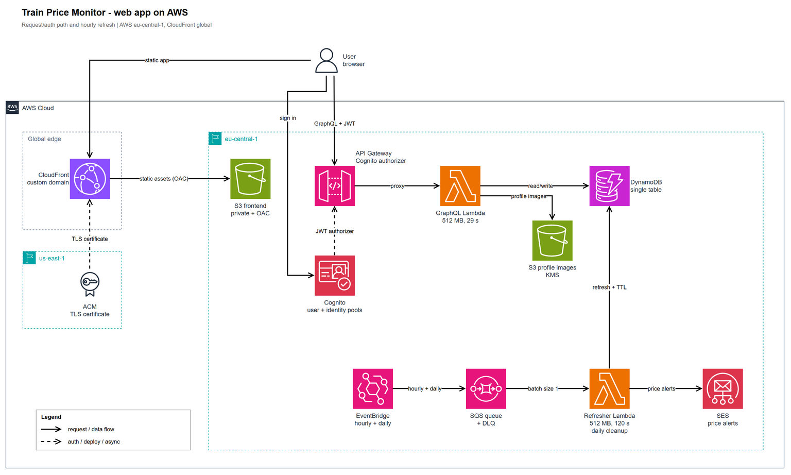
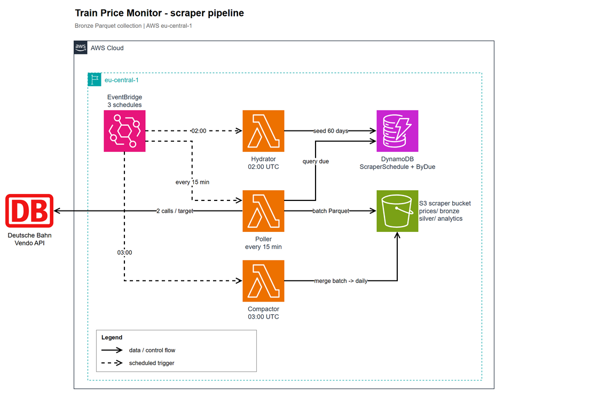
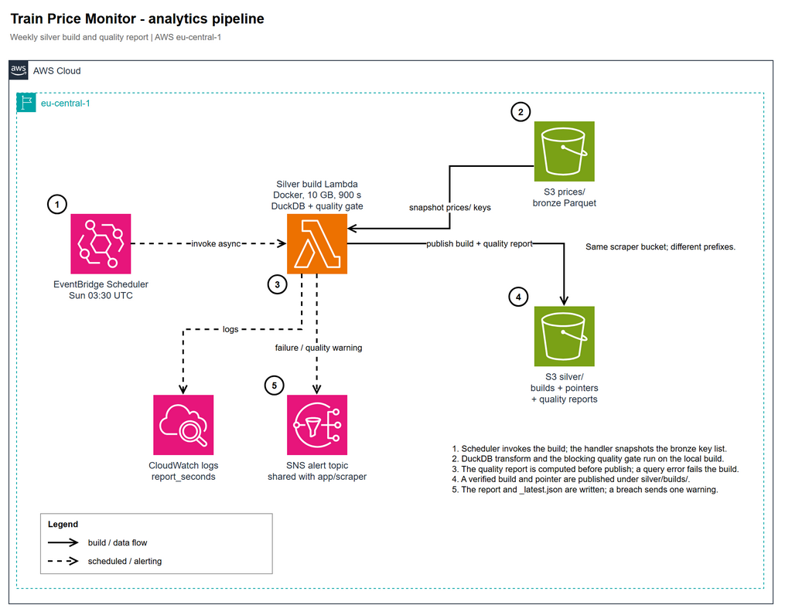

# Architecture

Train Price Monitor is a serverless web app plus two independent data pipelines. This document
explains the runtime shape, the main flows and the trade-offs behind them. The diagrams are editable
`.drawio.png` files; see [Diagrams](#diagrams) at the end.

## System context

- A **browser** runs the React single-page app, signs in with Cognito and calls the GraphQL API.
- The **web app** stores users, journeys and notifications in DynamoDB, profile images in S3 and
  sends user email through SES.
- A **scraper** collects Deutsche Bahn fares into Parquet on S3 on a schedule.
- A **weekly analytics build** reads that bronze data, normalises it with DuckDB and publishes a
  silver dataset plus a quality report.
- An **alerting stack** turns CloudWatch alarms, budget notifications and pipeline failures into
  Pushover messages.

The fare source is the Deutsche Bahn Vendo API. The backend and poller reach it through
`shared/db-fetch.ts`, which uses Node's `https` client with browser-like TLS profiles; the API and
refresher can fall back to Decodo when DB throttles the environment.

## Deployment topology

| Stack                 | Region         | Responsibility                                                                                                           |
| --------------------- | -------------- | ------------------------------------------------------------------------------------------------------------------------ |
| `CertificateStack`    | `us-east-1`    | ACM certificate for the CloudFront custom domain.                                                                        |
| `AlertingStack`       | `eu-central-1` | SNS alert topic, Pushover forwarder and the $1 monthly budget.                                                           |
| `InfrastructureStack` | `eu-central-1` | CloudFront/S3 frontend, Cognito, API Gateway/GraphQL Lambda, DynamoDB, profile S3, SQS/refresher, SES, `ToolkitCleaner`. |
| `ScraperStack`        | `eu-central-1` | Scraper schedules, Hydrator/Poller/Compactor and the schedule table.                                                     |
| `AnalyticsStack`      | `eu-central-1` | Weekly silver Lambda, EventBridge Scheduler, IAM, SNS failure path.                                                      |

The scraper and analytics stacks share the scraper S3 bucket. The alert topic is referenced by the
application, scraper and analytics stacks. Deployment details are in [deployment.md](deployment.md).

## Web application

**Request and auth path**

1. CloudFront serves the private S3 frontend through Origin Access Control. Two CloudFront Functions
   handle the custom-domain redirect, SPA routing and `X-Robots-Tag: noindex` on private routes.
2. The browser signs in to Cognito and sends the JWT to API Gateway. The REST API uses a Cognito user
   pool authorizer; every user-scoped resolver also checks the stored `cognitoSub`.
3. API Gateway proxies to the GraphQL Lambda (Docker image, 512 MB, 29 s). It reads and writes the
   single `TrainPriceMonitor` DynamoDB table and reads/writes profile images in S3. Journey search
   calls DB Vendo directly, with Decodo as the fallback.
4. The frontend uses urql with the Cognito token. The watchlist is rendered from the DynamoDB
   snapshot (`cached*` fields and `lastCheckedAt`) that the refresher maintains, so browsing the
   watchlist makes no DB call.

**Hourly and daily work**

- An EventBridge rule sends an `updateJourneyMonitors` message to SQS every hour. The refresher
  Lambda consumes one message at a time (visibility timeout 180 s, DLQ after three receives), updates
  each journey's cached price and creates a `PRICE_ALERT` when the current fare is **at or above** the
  user's limit. Email is sent through SES only when the user has email notifications enabled.
- A second EventBridge rule sends a daily `deleteUnconfirmedSignups` message. The refresher removes
  Cognito sign-ups that were never confirmed within the retention window.
- Expired journeys are deleted during refresh; their price-alert notifications are deleted with them.
  DynamoDB TTL is the backstop.

The API and refresher run the same Docker image with different timeouts, triggers and DB pacing.
Both use 512 MB; the API has a 29 s timeout for a waiting user, while the refresher has a 120 s
timeout and is sized for cost.

## Scraper pipeline

The scraper is an independent serverless pipeline. It does not share code with the web app beyond
the DB transport in `shared/`.

- **Hydrator** (02:00 UTC) seeds `ROUTE#<route>#DATE#<date>` items for the next 60 days. Conditional
  writes avoid overwriting existing targets. A full seed is available for backfills.
- **Poller** (every 15 minutes) queries the `ByDue` GSI once per TTD tier in NEAR → MID → FAR order,
  so near departures win when capacity is short. It reads up to 25 targets, makes two DB Vendo
  bestprice calls per target (first and second class), writes a `batch_*.parquet` file to
  `prices/year=/month=/day=/`, and reschedules each target. Targets whose departure day has passed
  are deleted instead of scraped.
- **Compactor** (03:00 UTC) merges the previous day's `batch_*` files into one `daily_*` file. It
  verifies row counts and content fingerprints before deleting the source files, and re-merges any
  existing daily data. A run with no `batch_*` files is a no-op, so retries are safe.

TTD intervals are capacity-derived: FAR 16 days, MID 8 days, NEAR 24 hours, with jitter. The poller
uses a browser-like TLS profile and a paced request schedule; it has **no Decodo fallback** because
bulk scraping must not spend the free fallback allowance. When DB throttles, the poller ends the
batch and leaves the remaining targets for the next run.

See [scraper/README.md](../scraper/README.md) for the Parquet schema, route catalog, tiers and Floci
development.

## Analytics pipeline

The silver build runs inside the existing weekly Lambda; there is no separate report function or
schedule.

1. EventBridge Scheduler invokes the Docker Lambda every Sunday at 03:30 UTC, after the 03:00
   compactor.
2. The handler lists the bronze `prices/**/*.parquet` keys once and builds from that list, so a
   poller batch landing mid-build is not added to the run. The list is not immutable: a compactor
   run that deletes a listed `batch_*` file before DuckDB reads it can still cause a missing-object
   failure. The 03:00 compactor and 03:30 build schedule normally leave a 30-minute gap; do not run
   them together.
3. DuckDB applies the deterministic silver transform, normalises v1/v2 semantics, joins station
   context and writes partitioned Parquet locally.
4. The blocking quality gate checks the invariants before anything is published. A gate failure
   fails the invocation and triggers the existing SNS on-failure path.
5. A verified build is published under `silver/builds/<build_id>/`, then the `silver/_latest.json`
   pointer is moved.
6. A weekly quality report is computed before publish; a query error fails the build before the
   pointer moves. After publish, the report and `silver/quality/_latest.json` are written. A
   threshold breach sends one normal-priority `silver_quality_failed` event; it does not roll back
   the build.

The Lambda has 10,240 MB memory, 900 s timeout, 10,240 MB ephemeral storage, no VPC and reserved
concurrency 1. It reads bronze and writes silver in the shared scraper bucket. Reports are kept
indefinitely; builds keep the newest two. The quality report and thresholds are documented in
[analytics/README.md](../analytics/README.md) and [operations.md](operations.md).

## Data model

The application uses one DynamoDB table, `TrainPriceMonitor`, with `pk`/`sk` access patterns:

| Access pattern                        | Item                                                                                         |
| ------------------------------------- | -------------------------------------------------------------------------------------------- |
| `USER#<userId>` / `METADATA#`         | User profile, notification switch, travel preferences and the Cognito `sub` binding.         |
| `USER#<userId>` / `JOURNEY#<id>`      | Journey monitor: price limit, refresh token, expiry and the cached price/departure snapshot. |
| `USER#<userId>` / `NOTIFICATION#<id>` | Price alert, journey expiry or stale-journey notification, with a JSON payload and TTL.      |

The table is on-demand, has point-in-time recovery and uses TTL on journeys and notifications. The
watchlist reads only the cached snapshot on the journey item; the refresher is the only writer.

## Data and retention

| Store                         | What lives there                                                                              | Retention                                                                                                                      |
| ----------------------------- | --------------------------------------------------------------------------------------------- | ------------------------------------------------------------------------------------------------------------------------------ |
| DynamoDB `TrainPriceMonitor`  | Users, journey monitors and notifications; single table, PITR, TTL on journeys/notifications. | Journey TTL after expiry + 7 days; notifications 90 days, but not before journey expiry + 7 days; unconfirmed sign-ups 7 days. |
| S3 profile images             | Per-user profile picture, KMS-encrypted.                                                      | Deleted with the account.                                                                                                      |
| S3 `prices/`                  | Bronze Parquet, written by the poller and compacted daily.                                    | Intended as the permanent historical record.                                                                                   |
| S3 `silver/builds/`           | Published silver snapshots and manifests.                                                     | Newest two builds.                                                                                                             |
| S3 `silver/quality/`          | Weekly quality reports and `_latest.json`.                                                    | Kept indefinitely for now.                                                                                                     |
| SQS                           | Hourly and daily internal messages.                                                           | 4 days; DLQ 14 days.                                                                                                           |
| CloudWatch / API Gateway logs | Operational logs.                                                                             | 14 days (CDK-managed).                                                                                                         |

The full data-protection rules are in [privacy.md](privacy.md); the public policy is linked from the
README.

## Alerting

CloudWatch alarms, AWS Budgets, silver build failures and quality warnings publish to the
`TrainPriceMonitorAlerts` SNS topic. The `PushoverForwarder` Lambda formats the message and sends it
to Pushover. Alarm state changes and build failures are high priority with the siren; recovery,
quality warnings and budget alerts are normal priority.

There are ten CloudWatch alarms, ten custom metrics and two dashboards. The alarm and custom-metric
allowances are fully used, and the third dashboard slot is free. Do not add an eleventh alarm or
custom metric without accepting the cost. See [operations.md](operations.md) for the alarm list and
runbooks.

## DB transport

DB's Akamai edge rejects every non-browser TLS/HTTP2 fingerprint with `403 OPS_BLOCKED`. This hit
Node fetch/undici, curl-impersonate, Bun and all db-vendo-client profiles in 2026-09. A real
Chromium worked until 2026-10-13, when DB also refused headless Linux browsers (real Chrome,
Chromium, Firefox, patchright, Camoufox, headless and headful) even from a residential IP, while a
Windows/macOS consumer browser on the same network was allowed. Bright Data's Browser API needed
business KYC (`int.bahn.de/robots.txt` disallows `/web/`), fell back to datacenter egress and billed
about 670 KB per session, so it was dropped. Kernel, Browserless (including OS emulation), ZenRows
and ScrapingAnt were tested on 2026-10-19 and are all refused.

What works is Node's own `https` client with a browser-like cipher list. DB matches the TLS
ClientHello, so the exact list and order is what passes: Firefox, Safari, a full Chrome list,
TLS-1.3-only and TLS-1.2-only orders all returned 201/200 on the real tagesbestpreis POST and the
locations endpoint, from a residential IP and from Lambda in eu-central-1. Node's default order and
the public 2026-10-20 Chrome order are refused. The transport carries six profiles (the five
measured orders plus `legacy` as a last resort), tries `DB_TLS_PROFILE` first and rotates on a
block.

The transport sends only the minimal headers DB accepts; db-vendo-client's own User-Agent and
correlation headers turn an accepted request into a 403. Pacing is measured too: 6 parallel calls
were fine, 60 at concurrency 6 got an IP a `429` for minutes, and 24 calls one at a time with 2.5 s
gaps passed. The shared module spaces request starts and caps in-flight requests; after repeated
failures the breaker stops calling DB for a cooldown. The backend and poller use the Navigator profile;
the backend has a Decodo fallback, the poller deliberately has no key.

Fingerprints get blocked once popular (db-vendo-client#46 reports days to weeks; the 2026-10-20
Chrome order was blocked on 2026-10-21), so the transport rotates firefox → safari → chrome → tls13
→ tls12 → legacy and skips a blocked profile for 15 minutes.

On 2026-11-23 the bahn.de web booking API (`/web/api/angebote/*`) began refusing every AWS Lambda
egress IP tested — six fresh eu-central-1 environments plus eu-west-1 and us-east-1 — with
`403 OPS_BLOCKED` on every TLS profile, while German residential egress still returned 201. The
caller cannot choose a Lambda egress IP, and no tested region was accepted. The scraper and backend
therefore use the DB Navigator API (`app.services-bahn.de`, `dbnav` profile), which returned 200
from the same Lambda egress and serves the same `tagesbestPreisIntervalle`; Decodo remains the
backend's fallback if the direct path fails. This is an egress/IP restriction, not a fingerprint
problem: when every profile fails, another profile or Lambda IP will not help.

## Design decisions

- **Serverless, no VPC.** Every workload is Lambda, API Gateway, DynamoDB, S3, SQS, SES or
  EventBridge. This keeps the cost and operational surface small; the trade-off is the 29 s API
  Gateway integration limit and the need to pace DB calls carefully.
- **Single DynamoDB table.** Users, journeys and notifications share `pk`/`sk`; access patterns are
  simple and the table stays in the free-tier-friendly on-demand mode.
- **SQS between the schedule and the refresher.** The hourly message is small and durable; a failed
  refresh can retry and land in the DLQ without affecting the API.
- **Pinned key list, not an immutable snapshot.** The silver build records the bronze key list
  before reading, so a concurrent poller append is not added to the run. A compactor delete of a
  listed batch can still race with the read; the 03:00 → 03:30 schedule normally leaves a 30-minute gap.
- **Blocking gate, non-blocking report.** Structural/data-contract problems fail the build before the
  pointer moves. Representativeness warnings are diagnostic and never roll back a verified dataset.
- **Browser-like TLS, no browser.** DB's edge matches the TLS ClientHello. The shared transport uses
  Node `https` with several browser-like profiles and rotates on `403 OPS_BLOCKED`; Decodo is the
  backend-only fallback. See [DB transport](#db-transport) for the measured history and
  `shared/db-fetch.ts` for the implementation.
- **Alert budget.** Ten alarms, ten custom metrics, two dashboards and a $1 monthly budget are the
  deliberate ceiling.

## Diagrams

- [Web app](diagrams/web-app-aws.drawio.png) — request/auth path and hourly refresh.
- [Scraper](diagrams/scraper-pipeline.drawio.png) — schedules, functions, schedule table and bronze S3.
- [Analytics](diagrams/analytics-pipeline.drawio.png) — weekly silver build and quality report.

Each file is a PNG with the drawio XML embedded, so it can be opened and edited directly in draw.io.
